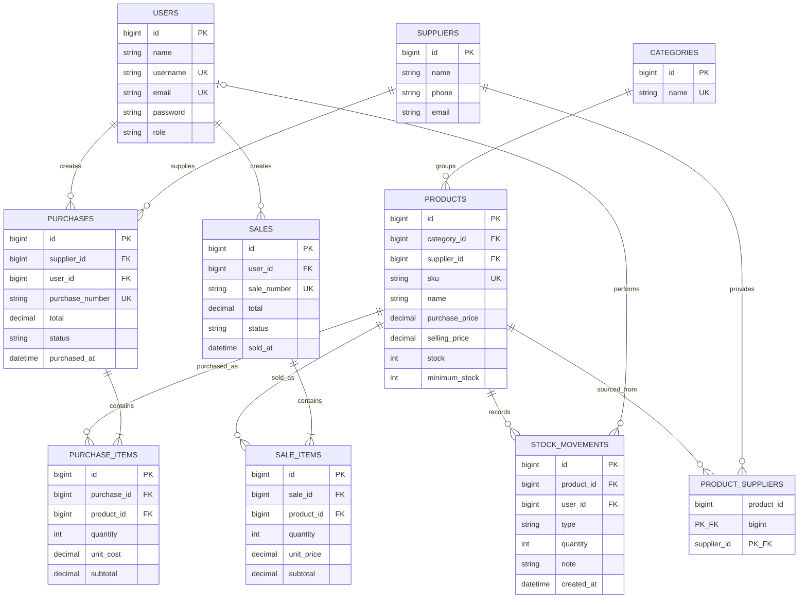

# ERD Final

Primary keys are surrogate IDs, except composite `(product_id, supplier_id)` on the legacy supplier pivot. Transaction detail rows have individual IDs and foreign keys. Product and user history references use `restrictOnDelete`; transaction detail rows cascade when their header is deleted, but UI has no transaction hard-delete. Monetary values use decimal columns, quantities use unsigned integer columns; request validation enforces positive quantities.
